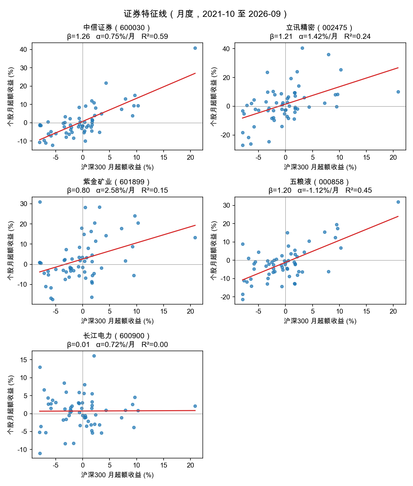
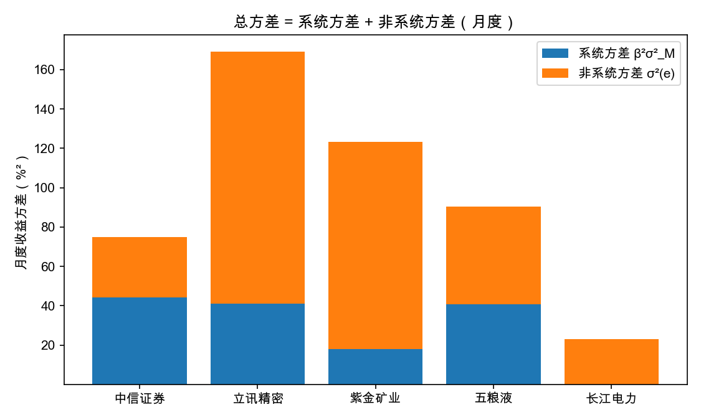
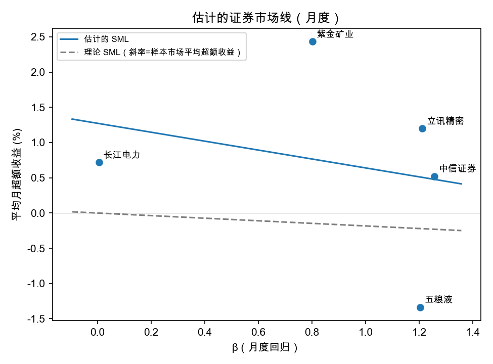
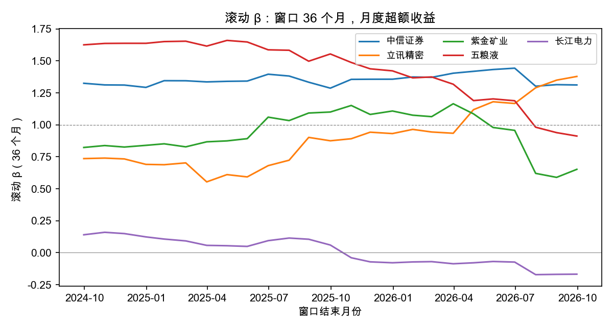
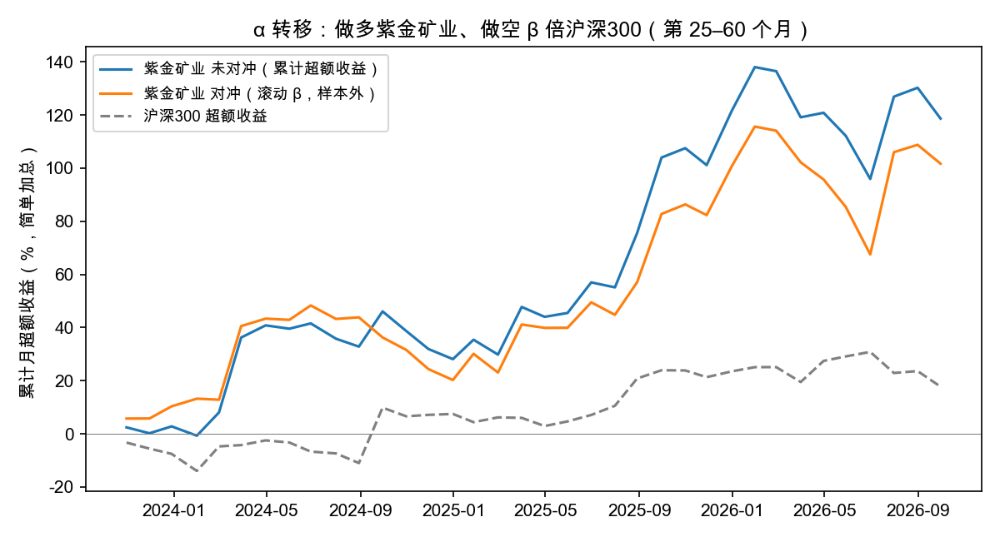
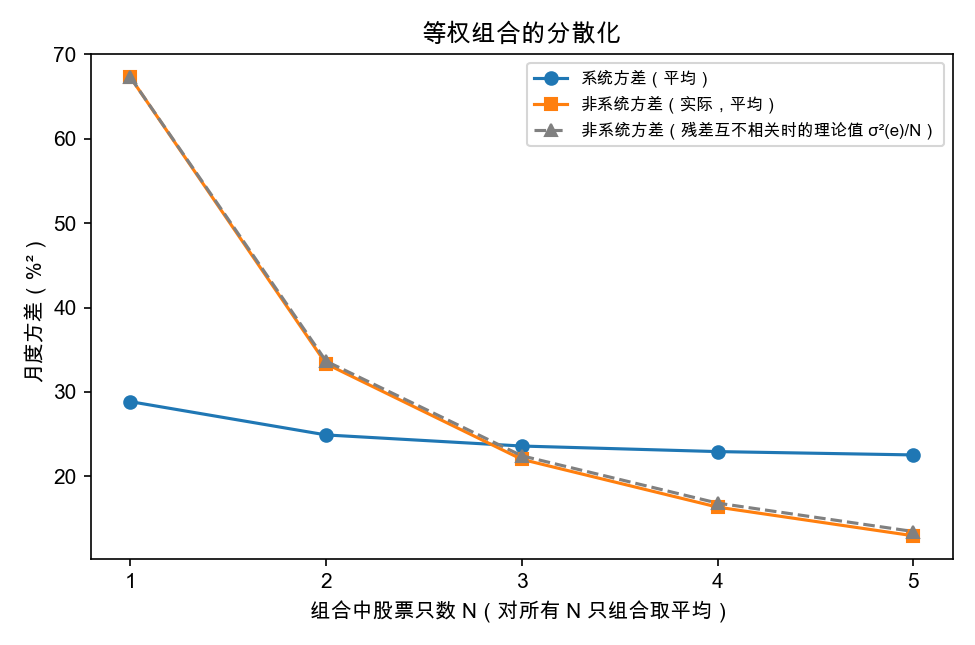

```{=latex}
\newpage
```

# 摘要 {.unnumbered}

本报告选取中信证券、立讯精密、紫金矿业、五粮液、长江电力五只行业各异的 A 股，以沪深 300 为市场代理、一年期整存整取利率为无风险利率，用 2021 年 10 月至 2026 年 9 月的 CSMAR 数据，分别在月度（60 期）、周度（254 期）和日度（约 1200 期）三种频率下估计证券特征线，并对回归结果做方差分析。主要发现：

1. 月度 $\hat\beta$ 从长江电力的 0.01 到中信证券的 1.26，涵盖了从几乎不随市场波动到略高于市场的区间；系统方差占总方差的比例（$R^2$）从 0.0% 到 59.1%。
2. 五只股票月度残差之间的相关系数在 -0.28 到 0.21 之间，量级不大，说明行业分散后单指数模型关于残差互不相关的假设大体成立。
3. 在 5% 水平上，只有紫金矿业的 $\hat\alpha$ 在周度（$t=2.16$）和日度（$t=2.21$）显著为正，月度 $p=0.059$ 处于边缘；其余四只均不显著。利用方式是做多该股、同时用沪深 300 股指期货对冲其 $\beta$，但在 5 只里挑 1 只显著的证据偏弱。
4. 样本期内市场平均超额收益为负（-0.18%/月），估计出的 SML 斜率为 -0.63%/月（$t=-0.44$），与 CAPM 的预期（斜率等于市场平均超额收益）没有显著差异；只有 5 个点，检验力很弱。
5. 拓展分析：稳健标准误与自助法下紫金矿业的 $\hat\alpha$ 结论不变；$\beta$ 在前后半样本间有明显漂移，Blume 调整在这 5 只股票上未改善预测；样本外对冲未带来改善；等权五只组合的非系统方差降至单只的约 1/5；$\hat\beta$ 对市场代理的选择高度敏感，但 SML 的结论稳健。

```{=latex}
\newpage
```

# 引言

单指数模型把一只证券的超额收益分解为与市场同涨同跌的部分和公司特有的部分：

$$
R_{it}=\alpha_i+\beta_iR_{Mt}+e_{it},\qquad R=r-r_f .
$$

本实践要求选取五只股票，估计证券特征线（SCL），对回归结果做方差分析，判断是否存在被低估的股票及其利用方式，并估计证券市场线（SML）、检验其与 CAPM 的一致性。选股时刻意让五只股票来自五个不同行业，一方面使 $\beta$ 有高有低、便于第 5 问的截面回归，另一方面使公司特有部分之间的相关性尽量小。在题面要求之外，第 6 节补充了稳健推断、$\beta$ 稳定性、对冲、分散化、市场代理敏感性和绩效指标六项拓展。**全部代码与中间结果见 <https://github.com/aylmerwawa/investments-lab3-scl>**；CSMAR 原始数据受使用授权限制，未随仓库发布，本报告仅保留口径说明、关键代码片段与结论性图表。

# 数据与方法

## 数据与样本

股票与指数的收益取自 CSMAR 的日个股回报率文件（考虑现金红利再投资的日个股回报率）和指数文件（指数回报率）；无风险利率取 CSMAR 无风险利率文件中的一年期整存整取利率（NRI01）的日度化值，由年利率按 $(1+r)^{1/365}-1$ 复利折算。样本窗口为 2021-10-01 至 2026-09-30，共 60 个整月；首个交易日 2021-10-11（国庆假期后），末个交易日 2026-09-30。

| 股票 | 代码 | 行业（2012 版证监会分类） | 日观测数 | 停牌缺失日 |
|-----|-------|-----------------------|------|------|
| 中信证券 | 600030 | 资本市场服务 | 1204 | 6 |
| 立讯精密 | 002475 | 计算机、通信和其他电子设备制造业 | 1210 | 0 |
| 紫金矿业 | 601899 | 有色金属矿采选业 | 1210 | 0 |
| 五粮液 | 000858 | 酒、饮料和精制茶制造业 | 1210 | 0 |
| 长江电力 | 600900 | 电力、热力生产和供应业 | 1199 | 11 |
| 沪深 300 | 000300 | 市场代理（指数） | 1210 | 0 |

: 样本股票与市场代理 {#tbl-sample}

## 超额收益的构造

- **周度和月度收益**：把日收益连乘得到期收益；停牌日的个股收益按 0 处理，复牌日的收益已经包含停牌期间的累计变化，连乘后不会重复。
- **无风险收益**：对每一期，从上期末（不含）到本期末（含）按日历日复利。
- **日度回归**：对中信证券和长江电力剔除停牌日及复牌日，因为复牌日的收益是多日累计值，与市场的单日收益不可比。
- **指数**：用沪深 300 代理市场组合；真正的市场组合不可观测，这是 Roll 批评所指出的局限。

周度、月度超额收益的核心计算如下：

```python
r = ret.reindex(trade_days).fillna(0.0)            # 停牌日个股收益按 0 处理
stk_p = (1 + r).groupby(period).prod() - 1         # 日收益连乘成周 / 月收益
ex = stk_p.sub(rf_p.values, axis=0)                # 减去同期无风险收益
```

## 回归与方差分析

对每只股票做 OLS，$R_{it}=\alpha_i+\beta_iR_{Mt}+e_{it}$。方差分析把样本方差分解为：

$$
\hat\sigma_i^2=\underbrace{\hat\beta_i^2\hat\sigma_M^2}_{\text{系统方差}}+\underbrace{\hat\sigma^2(e_i)}_{\text{非系统方差}},\qquad
R_i^2=\frac{\hat\beta_i^2\hat\sigma_M^2}{\hat\sigma_i^2} .
$$

这一分解成立的原因是 OLS 残差与 $R_M$ 样本协方差恒为 $0$。本文所有方差均用 $n-1$ 为分母，因此两块之和等于总方差。回归的整体显著性用 $F=\dfrac{R^2}{1-R^2}(n-2)$ 检验。

对应的计算如下：

```python
m = sm.OLS(y.values, sm.add_constant(x.values)).fit()  # y = a + b*x + e
sys_var = m.params[1] ** 2 * np.var(x.values, ddof=1)   # 系统方差 b^2 var(x)
nonsys = (m.resid ** 2).sum() / (n - 1)                 # 非系统方差
```

```{=latex}
\newpage
```

# 估计结果

## 证券特征线（月度）

```{=latex}
\Needspace{14\baselineskip}
```

| 股票 | $\hat\alpha$ | $t_\alpha$ | $\hat\beta$ | 标准误 | $t_\beta$ | $R^2$ | $\hat\sigma(e)$ |
|----------|------|------|------|------|------|------|-------|
| 中信证券 | 0.75% | 1.04 | 1.257 | 0.137 | 9.16 | 0.591 | 5.58% |
| 立讯精密 | 1.42% | 0.96 | 1.211 | 0.280 | 4.32 | 0.244 | 11.41% |
| 紫金矿业 | 2.58% | 1.93 | 0.802 | 0.254 | 3.15 | 0.146 | 10.35% |
| 五粮液 | -1.12% | -1.22 | 1.203 | 0.175 | 6.89 | 0.450 | 7.11% |
| 长江电力 | 0.72% | 1.15 | 0.006 | 0.119 | 0.05 | 0.000 | 4.83% |

: 月度证券特征线回归结果（$n=60$；$\hat\alpha$、$\hat\sigma(e)$ 为月度；$\hat\alpha$ 的双侧 $p$ 值依次为 0.302, 0.339, 0.059, 0.229, 0.254） {#tbl-reg}

完整明细见 `结果/01-特征线回归-月度.csv`（周度、日度同名，后缀为周度、日度）。读 @tbl-reg 可得：

- 中信证券的 $\hat\beta=1.26$，$R^2=0.59$，是五只中和市场联系最紧的，符合券商随市场情绪波动的直觉。
- 立讯精密（1.21）和五粮液（1.20）的 $\hat\beta$ 略高于 1，但 $R^2$ 分别只有 0.24 和 0.45，意味着多数波动来自公司自身或所属行业。
- 紫金矿业 $\hat\beta=0.80$，低于 1，同时 $R^2$ 仅 0.15，其收益更多由商品价格等自身因素驱动。
- 长江电力 $\hat\beta=0.006$，标准误 0.12，$R^2$ 接近 $0$：月度数据下它几乎与沪深 300 无关，这是防御型公用事业的典型特征。

{#fig-scl width=88%}

## 不同频率下的稳健性

```{=latex}
\Needspace{14\baselineskip}
```

| 股票 | 月度 $\hat\beta$ | 周度 $\hat\beta$ | 日度 $\hat\beta$ | 月度 $t_\alpha$ | 周度 $t_\alpha$ | 日度 $t_\alpha$ |
|-----|-------|-------|-------|-----|-----|-----|
| 中信证券 | 1.26（0.14） | 1.28（0.07） | 1.12（0.03） | 1.04 | 1.08 | 0.90 |
| 立讯精密 | 1.21（0.28） | 1.21（0.13） | 1.40（0.06） | 0.96 | 0.99 | 1.07 |
| 紫金矿业 | 0.80（0.25） | 0.92（0.12） | 1.07（0.05） | 1.93 | 2.16 | 2.21 |
| 五粮液 | 1.20（0.17） | 1.30（0.09） | 1.05（0.04） | -1.22 | -1.33 | -1.45 |
| 长江电力 | 0.01（0.12） | 0.11（0.06） | 0.15（0.03） | 1.15 | 1.23 | 1.21 |
| 观测数 | 60 | 254 | 1197–1210 | | | |

: 三种频率下的 $\hat\beta$ 与 $\hat\alpha$ 的 $t$ 值 {#tbl-freq}

同一只股票在不同频率下的 $\hat\beta$ 最多相差约 0.27（紫金矿业：月度 0.80，日度 1.07），而月度回归的标准误在 0.12 到 0.28 之间，差异大体落在 1 个标准误以内，不能认为频率改变了股票的系统风险。频率越高，观测越多，标准误越小（日度约 0.03–0.06），这就是长江电力日度 $\hat\beta=0.15$ 即显著、月度 0.01 却不显著的原因。另一方面，日度数据受非同步交易和微观结构噪声的影响更大，本文以月度为主要结果。

## 方差分析

```{=latex}
\Needspace{14\baselineskip}
```

| 股票 | 总方差 | 系统方差 $\hat\beta^2\sigma_M^2$ | 非系统方差 $\hat\sigma^2(e)$ | 系统占比 $R^2$ | $F$ | $p$（$F$） |
|---|---|---|---|---|---|---|
| 中信证券 | 75.0 | 44.4 | 30.6 | 59.1% | 84.0 | 0.000 |
| 立讯精密 | 169.1 | 41.2 | 127.9 | 24.4% | 18.7 | 0.000 |
| 紫金矿业 | 123.3 | 18.1 | 105.3 | 14.6% | 9.9 | 0.003 |
| 五粮液 | 90.4 | 40.7 | 49.7 | 45.0% | 47.4 | 0.000 |
| 长江电力 | 22.9 | 0.0 | 22.9 | 0.0% | 0.0 | 0.959 |

: 月度方差分析（方差单位：$\%^2$） {#tbl-va}

{#fig-va width=75%}

完整明细见 `结果/02-方差分析-月度.csv`、`结果/03-残差相关-月度.csv`。除长江电力外，其余四只的 $F$ 检验在 1% 水平上均显著，即市场因素对它们的月度收益有显著解释力；但系统方差占比从五粮液的 45% 到紫金矿业的 15% 不等，多数股票的大部分方差仍是可以通过分散化消掉的非系统方差。

月度残差的相关系数矩阵如下，除个别配对外都接近 $0$，与单指数模型的假设一致。若五只股票来自同一行业，这一矩阵通常会出现明显的正相关。

```{=latex}
\Needspace{14\baselineskip}
```

| | 中信证券 | 立讯精密 | 紫金矿业 | 五粮液 | 长江电力 |
|---|---|---|---|---|---|
| 中信证券 | 1 | -0.15 | -0.13 | 0.03 | 0.09 |
| 立讯精密 | -0.15 | 1 | 0.05 | -0.28 | 0.09 |
| 紫金矿业 | -0.13 | 0.05 | 1 | 0.09 | 0.08 |
| 五粮液 | 0.03 | -0.28 | 0.09 | 1 | 0.21 |
| 长江电力 | 0.09 | 0.09 | 0.08 | 0.21 | 1 |

: 月度回归残差的相关系数 {#tbl-rc}

# 被低估的股票及其利用

按 CAPM，公平定价的股票 $\alpha=0$；$\hat\alpha>0$ 说明同样的 $\beta$ 下期望收益高于 SML 的要求，价格偏低（低估）。只看符号不够，还要看统计显著性。

- 月度下五只的 $\hat\alpha$ 中，紫金矿业最大（2.58%/月，$t=1.93$，$p=0.059$），在 10% 水平显著；周度、日度下分别为 $t=2.16$、$t=2.21$（$p=0.032$、$p=0.027$），在 5% 水平显著。
- 五粮液的 $\hat\alpha$ 为负（-1.12%/月），但不显著，只能说有高估的迹象，不能下结论。
- 中信证券、立讯精密、长江电力的 $\hat\alpha$ 与 $0$ 没有显著差异。

**利用方式（$\alpha$ 与 $\beta$ 的分离）**：若认定紫金矿业被低估，可以买入该股，同时卖出沪深 300 股指期货，对冲的名义金额约为持仓市值乘以 $\hat\beta$（月度 0.80，日度 1.07），使组合的市场暴露接近 $0$，只留下 $\alpha$ 与公司特有风险。

需要提醒的限制：

1. 这是样本内估计，$\alpha$ 的标准误高达 1.34%/月，未来未必延续；
2. 在 5 只股票里挑最显著的一只，存在多重检验问题：若 5 只都真实公平定价，在 5% 水平上至少有一只显著的概率约为 $1-0.95^5\approx 23\%$；
3. 对冲有成本：股指期货的基差、展期、保证金占用，以及 $\hat\beta$ 本身的估计误差（月度与日度估计相差 0.27）。

```{=latex}
\newpage
```

# 估计证券市场线

对五只股票，用月度平均超额收益 $\bar R_i$ 对 $\hat\beta_i$ 做截面回归：$\bar R_i=\gamma_0+\gamma_1\hat\beta_i+u_i$。CAPM 要求 $\gamma_0=0$，$\gamma_1$ 等于市场溢价（这里用样本期市场平均超额收益 -0.18%/月代替）。

完整明细见 `结果/04-SML-月度.csv`、`结果/04-SML散点数据-月度.csv`。

```{=latex}
\Needspace{14\baselineskip}
```

| 股票 | $\hat\beta$ | 平均月超额收益 |
|---------|--------|-----------|
| 中信证券 | 1.257 | 0.52% |
| 立讯精密 | 1.211 | 1.20% |
| 紫金矿业 | 0.802 | 2.43% |
| 五粮液 | 1.203 | -1.34% |
| 长江电力 | 0.006 | 0.72% |

: 截面回归的数据点 {#tbl-pts}

```{=latex}
\Needspace{14\baselineskip}
```

| 项 | 估计 | 标准误 | $t$ | $p$ |
|---|---|---|---|---|
| 截距 $\gamma_0$（月） | 1.27% | 1.46% | 0.87 | 0.447 |
| 斜率 $\gamma_1$（月） | -0.63% | 1.44% | -0.44 | 0.689 |

: 估计的 SML（5 个点） {#tbl-sml}

{#fig-sml width=62%}

结果：截距 1.27%/月（$t=0.87$）、斜率 -0.63%/月（$t=-0.44$），两者与 CAPM 的预期（$\gamma_0=0$，$\gamma_1=-0.18%$）都没有显著差异。需要留意三点：

1. CAPM 说的是**期望**收益，样本期内实现的市场溢价为负（-0.18%/月）并不否定它；样本里 SML 的理论斜率本来就应为负，与估计出的斜率符号一致。
2. 只有 5 个点，且 $\hat\beta$ 含估计误差，检验力很弱，不能据此证明 CAPM 成立。
3. 用指数代理市场组合无法完全检验 CAPM（Roll 批评）：检验不通过不等于模型错误，通过也不等于模型对。

# 拓展分析

以下拓展不在题面要求之内，目的是检验主结果是否稳健，并把估计结果用起来。除特别说明外，均以月度超额收益为对象。脚本为 `拓展.py`，结果见 `结果/06` 至 `结果/11` 与 `fig-04` 至 `fig-06`。

## 回归诊断与稳健推断

OLS 的标准误假设残差同方差、无自相关。@tbl-diag 同时给出异方差稳健（HC3）、异方差与自相关稳健（Newey–West，滞后 3 期）标准误，以及对 $(R_{Mt},R_{it})$ 配对重抽样 5000 次的自助法 95% 区间，并列出残差的 Breusch–Pagan 异方差检验和 Jarque–Bera 正态性检验的 $p$ 值。

```{=latex}
\Needspace{14\baselineskip}
\begingroup\footnotesize
```

| 股票 | $\hat\beta$ | OLS 标准误 | HC3 标准误 | HAC 标准误 | 自助法 95% 区间 | $t_\alpha$（OLS / HC3 / HAC） | BP $p$ | JB $p$ |
|-----------|------|------|------|------|-------------------|----------------------|-----|-----|
| 中信证券 | 1.26 | 0.137 | 0.274 | 0.195 | [0.81, 1.59] | 1.04 / 0.96 / 0.90 | 0.010 | 0.145 |
| 立讯精密 | 1.21 | 0.280 | 0.399 | 0.349 | [0.69, 2.05] | 0.96 / 0.93 / 1.02 | 0.441 | 0.066 |
| 紫金矿业 | 0.80 | 0.254 | 0.286 | 0.286 | [0.29, 1.43] | 1.93 / 1.89 / 2.04 | 0.868 | 0.001 |
| 五粮液 | 1.20 | 0.175 | 0.234 | 0.242 | [0.69, 1.54] | -1.22 / -1.18 / -1.36 | 0.973 | 0.871 |
| 长江电力 | 0.01 | 0.119 | 0.118 | 0.136 | [-0.25, 0.23] | 1.15 / 1.15 / 1.56 | 0.122 | 0.058 |

: 稳健标准误、自助法区间与残差诊断（月度） {#tbl-diag}

```{=latex}
\endgroup
```

- **$\hat\beta$ 的显著性不变，但标准误变大。** 中信证券的 HC3 标准误（0.274）约为 OLS 的两倍，对应 Breusch–Pagan 检验 $p=0.010$，说明它的残差方差并不恒定；即便如此 $\hat\beta/\mathrm{se}$ 仍远大于 2。
- **紫金矿业的 $\hat\alpha$ 在稳健方法下仍处于边缘显著。** $t$ 值为 1.93（OLS）、1.89（HC3）、2.04（HAC）；自助法 95% 区间为 [0.10%, 5.32%]，下限刚好在 $0$ 之上。四种推断方式给出的是同一个结论：证据偏弱，但不是零。
- **紫金矿业的残差右偏、厚尾**（偏度 0.93，峰度 4.42，Jarque–Bera $p=0.001$），小样本下依赖正态性的 $t$ 检验不够可靠，自助法区间不依赖正态假设，是更稳妥的参照。Durbin–Watson 统计量在 1.72–2.45 之间，无明显自相关。

## $\beta$ 的稳定性与预测

CAPM 与单指数模型都隐含 $\beta$ 在样本期内不变。把 60 个月分成前后各 30 个月分别估计，并用交互项检验差异（@tbl-stab），再取 36 个月滚动窗口观察 $\beta$ 的路径（@fig-roll）。

```{=latex}
\Needspace{14\baselineskip}
\begingroup\footnotesize
```

| 股票 | 前 30 月 $\hat\beta$ | 后 30 月 $\hat\beta$ | 差 | $p$（差） | Blume 调整后 | 误差：未调整 | 误差：调整后 |
|-----------|--------|--------|------|------|--------|--------|--------|
| 中信证券 | 1.02 | 1.49 | +0.47 | 0.097 | 1.01 | 0.47 | 0.47 |
| 立讯精密 | 1.02 | 1.37 | +0.35 | 0.551 | 1.01 | 0.35 | 0.35 |
| 紫金矿业 | 1.00 | 0.64 | -0.37 | 0.487 | 1.00 | 0.37 | 0.36 |
| 五粮液 | 1.70 | 0.85 | -0.85 | 0.013 | 1.47 | 0.85 | 0.62 |
| 长江电力 | 0.20 | -0.18 | -0.38 | 0.117 | 0.47 | 0.38 | 0.65 |
| 平均 | | | | | | 0.483 | 0.492 |

: 前后半样本的 $\hat\beta$ 与 Blume 调整的样本外误差 {#tbl-stab}

```{=latex}
\endgroup
```

{#fig-roll width=82%}

- **只有五粮液的 $\beta$ 显著变化**：由前半的 1.70 降到后半的 0.85（$p=0.013$）；其余四只的差异都不显著，但点估计的变动幅度并不小（长江电力由 0.20 到 -0.18），说明 30 个月的窗口下 $\hat\beta$ 的估计误差本身就很大，滚动路径的起伏有相当一部分是噪声。
- **Blume 调整（课件 p20）在这 5 只股票上没有改善预测。** 用前半样本的 $\hat\beta$ 预测后半样本，$\frac23\hat\beta+\frac13$ 的平均绝对误差为 0.492，不调整为 0.483。向 1 靠拢在 $\hat\beta$ 极端偏高的五粮液上有效（误差 0.85 降到 0.62），在 $\beta$ 本来偏低的长江电力上反而更差（0.38 升到 0.65）。只有 5 个点，不足以对调整本身下一般结论。
- **Merrill Lynch 总收益回归（课件 p19）。** 不减无风险利率、直接用总收益率回归，斜率与超额收益回归的 $\hat\beta$ 最多相差 0.0016，截距与 $\hat\alpha+(1-\hat\beta)\bar r_f$ 在小数点后四位一致，与课件推导的关系相符。

## $\alpha$ 与 $\beta$ 的分离：对冲后的表现

按课件 p18，认定紫金矿业被低估后，买入该股并卖出 $\hat\beta$ 倍的沪深 300，使市场暴露接近零。@tbl-hedge 比较未对冲、样本内 $\hat\beta$ 对冲和样本外对冲（每月只用此前数据估 $\beta$，最少 24 个月）的表现；样本外一栏同时给出同一区间未对冲的结果以便对照。

```{=latex}
\Needspace{14\baselineskip}
\begingroup\footnotesize
```

| 组合 | 年化超额收益 | 年化波动 | 年化夏普 | 与市场相关 |
|----------------------------|--------|--------|--------|--------|
| 未对冲 | 29.2% | 38.5% | 0.76 | 0.38 |
| 样本内β对冲 | 30.9% | 35.5% | 0.87 | -0.00 |
| 样本外对冲（第25–60月） | 33.9% | 41.0% | 0.83 | -0.14 |
| 未对冲（第25–60月） | 39.6% | 42.0% | 0.94 | 0.29 |

: 紫金矿业对冲前后的表现（月度超额收益年化；样本外为第 25–60 个月） {#tbl-hedge}

```{=latex}
\endgroup
```

{#fig-hedge width=82%}

- **样本内**，对冲后年化波动由 38.5% 降到 35.5%，夏普由 0.76 升到 0.87，与市场的相关系数为 $0$（回归残差的定义使然）。
- **样本外**，对冲没有带来改善：同一区间夏普从 0.94 降到 0.83，对冲后与市场仍有 -0.14 的相关。
- 原因有两个：其一，紫金矿业的 $R^2$ 仅 0.15，对冲能去掉的方差很少；其二，$\hat\beta$ 的估计误差（前后半样本相差 0.37）使对冲比例并不准。这也说明在 $R^2$ 低的股票上，$\alpha$ 转移的收益主要来自 $\alpha$ 本身，而 $\alpha$ 的统计证据又偏弱。

## 等权组合与分散化

课件 p21–23 说明，等权组合的 $\alpha$、$\beta$ 是各只的平均，非系统方差随 $N$ 增加按 $\sigma^2(e)/N$ 下降。@tbl-div 对 $N=1,\dots,5$ 的所有等权子组合分别回归并取平均。

```{=latex}
\Needspace{14\baselineskip}
\begingroup\footnotesize
```

| $N$ | 组合数 | 平均总标准差 | 平均系统方差 | 平均非系统方差（实际） | 非系统方差（理论 $\sigma^2(e)/N$） |
|----|------|----------|----------|--------------|--------------------|
| 1 | 5 | 9.81% | 28.9 | 67.3 | 67.3 |
| 2 | 10 | 7.63% | 24.9 | 33.3 | 33.6 |
| 3 | 10 | 6.75% | 23.6 | 22.0 | 22.4 |
| 4 | 5 | 6.27% | 22.9 | 16.3 | 16.8 |
| 5 | 1 | 5.96% | 22.5 | 12.9 | 13.5 |

: 等权组合的方差分解（月度，方差单位：$\%^2$） {#tbl-div}

```{=latex}
\endgroup
```

{#fig-div width=70%}

- 平均总标准差由 $N=1$ 的 9.81% 降到 $N=5$ 的 5.96%；非系统方差由 67.3 降到 12.9，与理论值 $\sigma^2(e)/N$（13.5）几乎一致，说明五只股票的残差之间的相关很弱，分散化接近理想情形。
- 五只全部等权的组合：$\hat\beta=0.896$，正好是五只 $\hat\beta$ 的平均（0.896，OLS 对组合的线性性）；$\hat\alpha=0.87%$/月（$t=1.86$），等于各只 $\hat\alpha$ 的平均；$R^2=0.64$，高于其中四只单只的 $R^2$。
- 系统方差也随 $N$ 略降（28.9 到 22.5），因为组合 $\hat\beta$ 的平方不超过各只 $\hat\beta^2$ 的平均（凸性），并不是分散化消除了市场风险。

## 市场代理的敏感性

真正的市场组合不可观测，所谓「市场」只是某个指数。用本次已下载的几个指数分别作代理，重估 $\hat\beta$（括号内为 $R^2$）：

```{=latex}
\Needspace{14\baselineskip}
\begingroup\footnotesize
```

| 股票 | 沪深300 | 中证100 | 上证综指 | 深证综指 |
|-----------|-------------|-------------|-------------|-------------|
| 中信证券 | 1.26（0.59） | 1.19（0.56） | 1.39（0.52） | 0.81（0.40） |
| 立讯精密 | 1.21（0.24） | 1.26（0.28） | 1.16（0.16） | 0.97（0.25） |
| 紫金矿业 | 0.80（0.15） | 0.87（0.18） | 0.91（0.14） | 0.45（0.07） |
| 五粮液 | 1.20（0.45） | 1.17（0.45） | 1.30（0.37） | 0.73（0.27） |
| 长江电力 | 0.01（0.00） | 0.02（0.00） | -0.00（0.00） | -0.15（0.05） |

: 不同市场代理下的 $\hat\beta$（$R^2$）（月度） {#tbl-px}

```{=latex}
\endgroup
```

```{=latex}
\Needspace{14\baselineskip}
\begingroup\footnotesize
```

| 市场代理 | 样本期月均超额收益 | $\hat\gamma_0$（$t$） | $\hat\gamma_1$（$t$） |
|--------|--------|----------|----------|
| 沪深300 | -0.18% | 1.27%（0.87） | -0.63%（-0.44）|
| 中证100 | -0.21% | 1.13%（0.74） | -0.47%（-0.31）|
| 上证综指 | 0.10% | 1.28%（0.88） | -0.60%（-0.45）|
| 深证综指 | 0.10% | 0.99%（0.82） | -0.51%（-0.29）|

: 不同市场代理下的截面回归 $\bar R_i=\gamma_0+\gamma_1\hat\beta_i+u_i$（5 个点） {#tbl-sp}

```{=latex}
\endgroup
```

上证 A 股与上证综指、深证 A 股与深证综指的结果几乎相同（B 股占比很小），故表中只列四组。

- **$\hat\beta$ 对代理的选择很敏感**：同一只股票在沪深 300 与深证综指下的 $\hat\beta$ 差别很大（紫金矿业 0.80 对 0.45，中信证券 1.26 对 0.81），$R^2$ 也更低。深证综指本身的月波动更大（6.71% 对沪深 300 的 5.30%），而个股与它的相关性又更低，两者共同使 $\hat\beta$ 变小。
- **样本期内市场平均超额收益的符号随代理而变**：沪深 300 为 -0.18%，上证综指为 0.10%。
- **结论仍稳健**：四种代理下 $\hat\gamma_1$ 都为负且不显著（$t$ 在 -0.29 到 -0.45 之间），$\hat\alpha$ 的 $t$ 值变化不大（紫金矿业 1.72–1.99），第 4、5 问的结论不依赖具体选用哪个指数。

## 绩效指标

课件 p17 给出夏普比率和詹森 $\alpha$。@tbl-pf 再补充特雷诺比率（超额收益除以 $\beta$）与信息比率（$\alpha$ 除以残差标准差，年化）。

```{=latex}
\Needspace{14\baselineskip}
\begingroup\footnotesize
```

| 股票 | 年化夏普 | 特雷诺（月） | 詹森 $\alpha$（月） | 信息比率（年化） |
|-----------|----------|-----------|-----------|------------|
| 中信证券 | 0.21 | 0.41% | 0.75% | 0.47 |
| 立讯精密 | 0.32 | 0.99% | 1.42% | 0.43 |
| 紫金矿业 | 0.76 | 3.03% | 2.58% | 0.86 |
| 五粮液 | -0.49 | -1.11% | -1.12% | -0.54 |
| 长江电力 | 0.52 | — | 0.72% | 0.52 |
| 沪深300 | -0.12 | -0.18% | 0.00% | — |

: 单只股票的绩效指标（月度） {#tbl-pf}

```{=latex}
\endgroup
```

按夏普排序为紫金矿业、长江电力、立讯精密、中信证券、五粮液；按詹森 $\alpha$ 排序则立讯精密、中信证券居前，长江电力排到第四。差别来自风险的度量：夏普用总风险，长江电力几乎不承担市场风险、总波动又很小，所以夏普靠前；詹森 $\alpha$ 只扣除 $\beta$ 对应的部分，不奖励低波动。长江电力的 $\hat\beta\approx0$，特雷诺比率无意义，故未列。市场自身的样本期夏普为 -0.12，为负。

# 局限与讨论

- **样本期与窗口**：只有 5 年、5 只股票，估计误差大，尤其是低 $R^2$ 股票的 $\hat\beta$。
- **市场代理**：沪深 300 只覆盖大盘股，不是包含所有资产的市场组合。
- **无风险利率**：用定期存款利率代替国债收益率或货币市场利率，水平较低（样本期 0.95%–1.65%），对超额收益的影响很小，但口径需说明。
- **停牌处理**：周度、月度通过连乘保留停牌期间的价格变化，日度回归剔除了停牌日与复牌日，两种处理在结论上没有实质差异。
- **残差相关**：五只来自不同行业时残差相关很小；若换成同一行业，单指数模型的假设会被明显违反。

# 结论

综合上述分析，可以得到以下结论：

1. **系统风险差异显著。** 五只股票月度 $\hat\beta$ 从 0.01（长江电力）到 1.26（中信证券），$R^2$ 从 0.0% 到 59.1%，即使同为大盘股，不同行业对市场的暴露也可以相差很大，仅看总波动不足以判断一只股票承担了多少市场风险；
2. **多数股票的大部分方差是非系统的。** 除中信证券外，其余四只的系统方差占比均不足一半，这部分风险可以通过跨行业分散化消除，因此 CAPM 并不为它定价；五只股票残差之间的相关系数在 -0.28 到 0.21 之间，与单指数模型的假设一致；
3. **低估的证据偏弱。** 紫金矿业的 $\hat\alpha$ 在周度、日度下 5% 显著、月度边缘显著，但 $\alpha$ 的标准误较大，且存在多重检验与样本内估计的问题，因此只能作为被低估的线索，而非可靠的套利机会；
4. **SML 的检验力有限。** 在样本期市场平均超额收益为负的情形下，五只股票的截面回归斜率为 -0.63%/月（$t=-0.44$），与 CAPM 的预期没有显著差异；但仅有 5 个点，且 $\hat\beta$ 含估计误差，不足以证明或否定 CAPM。
5. **主结论经得起稳健性检验，但 $\beta$ 本身不够稳。** 稳健标准误、自助法和不同市场代理都没有改变关于 $\alpha$ 与 SML 的判断，但前后半样本的 $\hat\beta$ 有明显漂移、不同市场代理下 $\hat\beta$ 差异可达七八成，说明在只有 60 个月、$R^2$ 又不高的情形下，把 $\hat\beta$ 当作稳定的风险暴露要格外谨慎。

# 附录：结果自检 {#sec-appendix}

脚本在输出结果的同时做了以下自检，全部通过：

| 检查项 | 结果 | 要求 |
|--------------------|----------|----------------|
| 斜率 = Cov(y,x)/Var(x) | 1.11e-15 | 最大绝对差 < 1e-10 |
| 总方差 = 系统方差 + 非系统方差 | 6.94e-18 | 最大绝对差 < 1e-10 |
| 残差与市场的样本协方差 = 0 | 2.48e-18 | 最大绝对值 < 1e-10 |
| 月度期数 | 60 | 60 |
| 周度期数 | 254 | — |
| 月度超额收益缺失值个数 | 0 | 0 |

: 结果自检 {#tbl-ck}

